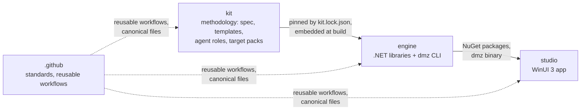

# Architecture of the organization

Delphi Modernizer is four repositories with one dependency direction:

## What each repository owns

| Repository | Owns | Never contains |
| --- | --- | --- |
| `kit` | `spec/` (ID grammar, deliverables D01–D20, gates G0–G4, front-matter schema), the workspace template, agent and skill definitions, target packs with quality baselines | product code |
| `engine` | Delphi scanner, traceability checker, workspace manifest and gates, guard hook, Claude Code runner, `dmz` CLI, the KH analyzers | UI code, methodology text |
| `studio` | The WinUI 3 app: workspace wizard, dashboards, agent runs, approvals | scanning, tracing or gate logic (it calls the engine) |
| `.github` | Organization defaults, standards, reusable workflows | anything a single repository owns |

## A modernization workspace

A team runs the studio (or `dmz init`) against a Delphi codebase and gets a workspace: a folder, ideally its own
private git repository, holding the legacy source under `legacy/`, the kit's templates under `docs/`, the agent
definitions under `.claude/`, and machine state under `.modernizer/`. Markdown with IDs is the source of truth
([ADR 0003](adr/0003-markdown-with-ids-is-the-source-of-truth.md)). A person approves each gate
([ADR 0004](adr/0004-approvals-are-human-only.md)); Claude Code agents draft the deliverables
([ADR 0002](adr/0002-claude-code-is-the-agent-runtime.md)).

## Versioning and compatibility

Each repository follows SemVer on its own tags.

- **kit**: a major version changes the spec — ID grammar, gate criteria or the workspace layout — so existing workspaces
  need a migration.
- **engine**: embeds exactly one kit version, recorded in `kit.lock.json`. A workspace records the kit version it was
  created from in `modernizer.json`; the engine refuses a workspace whose kit major version is newer than its own.
- **studio**: pins an engine version in `Directory.Packages.props` and shows the engine and kit versions it runs.

Before the first release tags exist, `kit.lock.json` and the studio's `engine.lock` pin commit SHAs, and the studio
builds the engine from source (`-p:EngineSource=Source`). Both repositories are public, so CI needs no token for that.

## Releases

| Repository | Tag | Produces |
| --- | --- | --- |
| `kit` | `vX.Y.Z` | `kit-vX.Y.Z.zip` and `SHA256SUMS` on a GitHub Release |
| `engine` | `vX.Y.Z` | NuGet packages on GitHub Packages; self-contained `dmz` for win-x64, linux-x64 and osx-arm64 with `SHA256SUMS` |
| `studio` | `vX.Y.Z` | the app, unpackaged and MSIX, on a GitHub Release |

Packages are published to GitHub Packages ([ADR 0005](adr/0005-packages-are-published-to-github-packages.md)).
