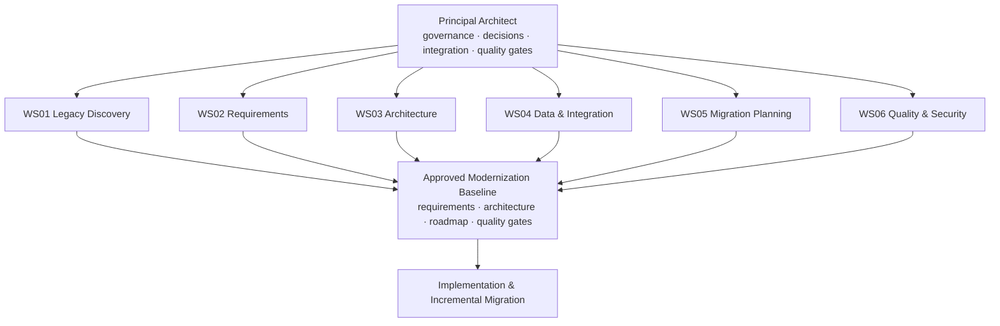

# Delphi Modernizer

A governed path from a legacy Delphi codebase to a modern C#/.NET or Java system. Discovery and planning come first,
every claim carries evidence from the legacy source, and nothing is implemented until a person approves the
modernization baseline.

| Repository | Contents |
| --- | --- |
| [kit](https://github.com/delphi-modernizer/kit) | The methodology: agent roles, deliverable templates D01–D20, the ID scheme, gates G0–G4 and the .NET and JVM target packs |
| [engine](https://github.com/delphi-modernizer/engine) | Cross-platform .NET libraries and the `dmz` CLI: Delphi scanner, traceability checker, workspace gates, agent runner |
| [studio](https://github.com/delphi-modernizer/studio) | The WinUI 3 desktop app that drives a modernization workspace |
| [.github](https://github.com/delphi-modernizer/.github) | Organization defaults, [engineering standards](https://github.com/delphi-modernizer/.github/blob/main/standards/STANDARDS.md) and reusable workflows |

The kit flows into the engine, and the engine into the studio. The engine and the gates work without any AI; Claude Code
agents are the optional workforce that drafts the deliverables, and people approve every gate.

Status: early development. MIT licensed.
